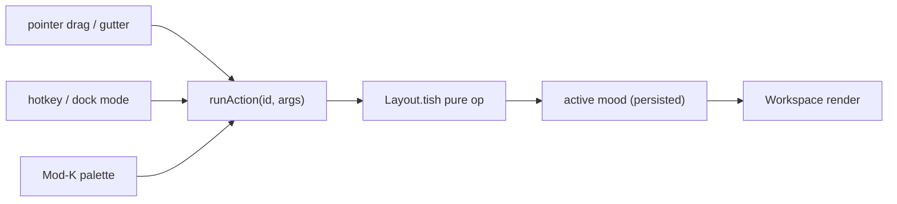

# UI/UX Overhaul — Studio and Stage

Status: **phase 1 shipped (workspace shell)** · Supersedes the layout parts of [UI_REDESIGN.md](UI_REDESIGN.md)
(its deck/stem/crossfader model still stands and is what the Stage mood hosts).

Deckard does two jobs: **production** (a DAW) and **live performance** (a DJ booth). You rarely need every tool
for both at once, and the room is shared with other humans and AI co-DJs. No existing app has that shape, so the
UI is built around it instead of copying FL Studio or Rekordbox.

## Five ideas

1. **One canvas, two moods.** *Studio* (produce) and *Stage* (perform) are two saved layouts of one dockable
   workspace, not two apps. `` ` `` (backtick) morphs between them — panels FLIP-animate to their new homes, and a
   panel used in both moods keeps its identity and slides rather than vanishing. Users can save their own moods
   ("Sound design", "B2B with AI"). `Mod-1..9` jumps straight to a mood.
2. **Every panel has a lens.** A panel is a *type* (decks, mixer, sequencer, instruments, …) plus a *target*:
   `deck:A`, `track:c3`, `peer:agent-x`, or `follow` (tracks your selection). Pin a lens to hold a panel on one
   thing. Pointing a deck panel at a peer is how you see another DJ's decks and instruments.
3. **Booths.** Every performer in the room is a booth: an avatar ring in the top bar pulsing with their level.
   Opening a booth gives a read-only, colour-tinted peek of their decks/instruments with **Follow**, **Borrow**
   (fork a track via ownership/merge) and **Ask** (chat).
4. **Ghosts of the future.** Co-DJ writes are already scheduled to future steps (`coDjScheduled`). They render
   before they land — ghost notes, ghost knob arcs, a ghost crossfader — in the author's colour, with a countdown
   and a one-key veto. That is both the fun and the trust layer.
5. **Keyboard parity, no exceptions.** Every mouse gesture is an *action* with a hotkey; drag/drop and keys call
   the same `runAction`. A test fails if a drag gesture exists without a bound action.

## Architecture (phase 1)

```
src/workspace/            pure, tested (test/workspace.tish)
  Layout.tish             layout tree: split / stack / floating; split, move, close, resize, float, normalize, serialize
  Panels.tish             panel types + lens model + resolveLens + parseLensInput
  Moods.tish              built-in Studio / Stage + user moods, localStorage persistence (deckard.moods.v1)
  Actions.tish            the one action registry (id, label, group, keys, when, run)
  Keymap.tish             chord parsing (Mod = Cmd on mac / Ctrl elsewhere), scopes, conflicts, rebinding (deckard.keymap.v1)
  Spatial.tish            nearest-panel-in-direction (spatial focus + keyboard dock targeting)
src/ui/shell/             layout + wiring only
  Workspace.tish          renders the tree; gutters; floating windows; maximise
  PanelFrame.tish         chrome: title, lens chip, float/close, colour edge, beat glow, ARIA
  DragDock.tish           imperative pointer drag of tabs + gutter resize → runAction on drop
  MoodMorph.tish          FLIP animation between moods
  FocusRing.tish          focus restore by data-focus-id across re-renders, focus levels, roving tabindex
  Keyboard.tish           global key dispatcher + keyboard dock/resize modes + key-hint overlay
  CommandPalette.tish     Mod-K: actions, panels, moods, lens retarget, raw deck lines (">"), co-DJ chat
  TopBar.tish             logo, transport, mood dial, booth ring, palette button
  PanelRegistry.tish      panel type → existing renderer (DeckNav, InstrumentStack, StepGrid/Session, …)
  Announcer.tish          aria-live polite announcements
```



### Constraints that shape the code

- Lattish re-renders the whole tree on each flush. Drag, resize and morph are **imperative** (ghost element,
  `flex-basis` / transform writes) and commit one state change on release. Heavy panels stay memoised.
- Focus is restored by stable `data-focus-id` in a layout effect after every flush, so keyboard navigation
  survives re-renders.
- Layout is UI state (localStorage), never project state — it is not part of deck and does not broadcast.

### Default shell keymap

| Keys | Action |
|---|---|
| `F6` / `Shift-F6` | next / previous panel |
| `Mod-Alt-Arrow` | focus nearest panel in that direction |
| `` ` `` / `Mod-1..9` | toggle Studio/Stage / jump to mood N |
| `Mod-K` | command palette |
| `?` | key-hint overlay (badge letters focus/activate controls) |
| `Mod-Shift-[` / `]` | previous / next tab in stack |
| `Mod-W` / `Mod-Shift-T` | close panel / reopen last closed |
| `Mod-\` / `Mod-Shift-\` | split right / split down |
| `Mod-Shift-F` | float / dock |
| `Mod-Shift-Enter` | maximise / restore |
| `Mod-L` | focus lens chip (type `a`, `b`, `c3`, `@agent-x`, `follow`; `P` pins) |
| `Mod-M` | dock mode: arrows pick target, `Shift-Arrow` edge, `T` tab, `F` float, `Enter` commit, `Esc` cancel |
| `Mod-R` | resize mode: arrows 2% (`Shift` 10%) |
| `Enter` / `Esc` | on a panel frame: enter the panel / back to the frame |

Existing performance keys are unchanged: `Space` preview, `Enter` play/stop (when not on a panel frame), hold
`E` echo, hold `F` filter, `C` cue, hold `V` cut, `Mod-Z` / `Mod-Shift-Z` undo/redo.

## Roadmap

1. **Phase 1 — workspace shell** (this doc's architecture). Every existing surface becomes a panel; no features lost.
2. **Phase 2 — Studio core.** Arrangement timeline (clips, structure ribbon, markers), pro piano roll (velocity /
   probability lanes, scale highlight, chord stamps, ghost notes), mixer console (meters, inserts, sends, groups,
   automation lanes), instrument macro face, history panel with author colours.
3. **Phase 3 — Stage core.** Scrolling synthesised waveforms + beatgrid + phrase counter, hot cues (clips/scenes),
   loop roll, stem faders, FX XY pads, crossfader curves, one-button blend (`codj.blend`), next-up crate,
   4x4 performance pads with MIDI-learn.
4. **Phase 4 — Booths.** Booth ring with live levels, peer peek panels from `Mirror`, Follow / Borrow / Ask,
   presence cursors.
5. **Phase 5 — AI in TypeScript + ghosts.** Agents author TypeScript against a strict `codj.d.ts` (types
   stripped before `ScriptHost`); deck stays the wire and source of truth. Expanded API (arrangement, automation,
   inserts/sends, stems, hot cues, FX, `codj.ui.spotlight`). A Translation panel shows each script write's compiled
   deck diff. Ghost overlays from `coDjScheduled` with veto.
6. **Phase 6 — fun layer.** Beat-reactive themes, drop moments, a first-run guided jam, shareable set replays.

Every later phase follows the keyboard-parity rule. Planned defaults: arrangement (arrows cursor, `Mod-Arrow`
nudge, `Shift-Arrow` resize, `S` split, `D` duplicate, `L` loop); piano roll (arrows, `N` note, `Alt-Up/Down`
velocity, `C` chord stamp); mixer (arrows between strips, `Up/Down` fine, `Shift` coarse); Stage (`Q W E R` deck
A cues, `U I O P` deck B, `1–5` stems, `Z` / `/` crossfader nudge, `Mod-Up/Down` crate order, `V` veto ghost).
